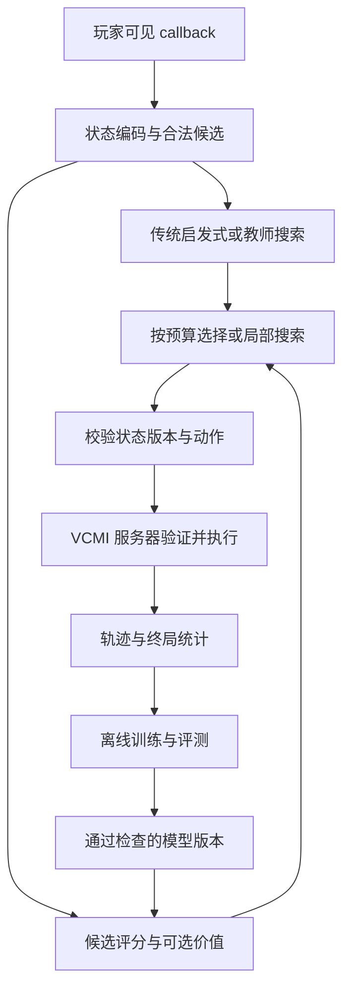

# AI 架构提案

日期：2026-10-13。以下均为[设计/推断]，已有接口事实见 [可行性报告](FEASIBILITY_REPORT.md) 与 [来源索引](research/SOURCES.md)。推荐先复用精确规则和传统规划，以同预算实验选择学习器。

## 1. 三条可实施路线

| 路线 | 实现方式 | 优势 | 风险/适用时机 |
|---|---|---|---|
| R1 传统搜索 + 学习评价 | BattleAI 启发式候选、有限交换/beam、监督 Value 或排序函数 | 最小接口改动，容易解释；没有 PPO 也可进步 | 教师偏差、近似模拟；适合首个竞争基线 |
| R2 动态候选评分 + 可选 Value（推荐） | 共享实体编码、候选特征、轻量注意力，输出每个合法候选 logit；可外挂小搜索 | 动态目标/位置/魔法可统一表达，小模型、BC/蒸馏/RL均适用 | 候选漏解、复杂魔法接口仍需开发；需测候选生成成本 |
| R3 v15 小型异构 GNN + PPO | 复用 Gym 图，Unit/Hex/Action 消息传递和共享 actor/critic | 已有代码路径，关系表达强、无需固定堆叠顺序 | 动态图边数、CPU 编码和缓冲内存可能主导；主动魔法仍要扩展 |

R1 与 R2 并行做算法比较不意味着本阶段启动开发。优先 R2 的轻量版用于本机；若 R3 在等数据、等决策预算下收益更高且部署通过，则切换。保留 R1 作为教师与故障回退。

## 2. 用户列出的模型/搜索逐项比较

| 方案 | 编码/输出 | 工程判断 |
|---|---|---|
| A MLP Policy | 固定 padding 状态 → 固定或候选共享 MLP | 速度基线强，顺序与关系泛化弱；先测，不当终局方案 |
| B Policy + Value | 共享编码，动作 logits 与当前局面值 | PPO 常用，搜索可用；BC 仅训 policy 时不强制 Value |
| C GNN/Graph Transformer | 图节点、邻接和影响边 | 小型 GNN 值得测；全图 Transformer 的平方注意力和部署成本需证据支持 |
| D 注意力候选评分 | 状态只编码一次，每候选读取相关实体 | 推荐；开销随候选数和实体数变化，不能每候选重跑完整状态网络 |
| E 分层 Decision Model | 战略目标 → 英雄/城镇任务 → 路径/执行；战斗独立 | Stage C/D 推荐；宏动作需中断与时长，不宜在基础战斗过度拆分 |
| F 启发式 + 学习值 | 原有搜索，叶节点学习评价 | 最容易隔离收益，教师可搜索蒸馏；值误差可被搜索放大 |
| G Policy/Value + 搜索 | Top-K、beam、机会节点 MCTS、局部 expectimax | 先低深度 beam/交换；精确 clone/restore 未验之前不能假设有廉价 MCTS |

AlphaZero 的完美信息交替对弈与 H3 的随机、英雄施法子阶段、联盟和迷雾不同；应借鉴先验/价值/搜索协同，不复制棋类吞吐或训练量。MuZero 学习动力学在已有精确规则条件下不是默认选择，可在远期宏动作近似模型上试验。[AlphaZero](https://arxiv.org/abs/1712.01815)、[MuZero](https://arxiv.org/abs/1911.08265)

## 3. 状态与行动契约

战斗状态包含可见英雄属性、己方可用法术/法力/本轮施法资格、兵堆数量与当前首兵 HP、速度、轮序、等待/防御/反击次数、弹药、有效 bonus/status 及剩余回合；战场 occupancy、障碍、墙/门/桥/壕沟，复活尸体、召唤/镜像来源和持久性。对方未知信息保留 unknown，不从引擎全状态泄漏。有效属性与原始技能身份可同时编码，但不能用随机英雄配置替代必要观测。

动态兵堆用集合/图及实体 ID；padding mask 独立于 legal action mask。召唤超过预期数量时动态扩容或显式回退，禁止静默截断。数量用 log1p 和相对规模等归一化，并保存原始整数供规则执行。固定一队七格不能代替战斗中动态单位总数。

六边形保留 VCMI hex ID 与六向邻接，必要时转轴坐标；模型不能用普通方格曼哈顿距离代替规则路径。v13 的 165 个有效内场 hex 与引擎原始完整格索引需显式映射。双格单位编码两格 footprint、朝向/所属 side 与占用边。合法移动、喷吐路径、尸巫影响集合、九头怪环攻与反击对象由规则接口计算，并作为候选边/特征提供，不由神经网络猜规则。

候选动作记录：`state_revision, actor_id, type, destination, target_ids, spell_id, ordered_spell_targets, flags, action_id`。包括 WAIT、DEFEND、MOVE、SHOOT、移动后近战、CAST、合法撤退/投降和系统自动动作。法术多目标须保留顺序，如瞬移的源兵堆和落点；全局法术也占一个候选。需要协议表明“施法后仍可兵堆行动”，避免错误消耗行动或同轮多次施法。

**全合法集合**先由规则层生成，若太大，使用候选剪枝且记录原始数量与剪枝原因。Top-K 之外保留至少各动作族代表、保命/控制动作及少量探索候选；训练比较全枚举小局面与剪枝的最优动作召回率。模型永远无法选择一个被生成器遗漏的战术。

固定输出方案在 softmax 前把非法 logits 置为负无穷；动态方案在每图 active candidates 上做分段 softmax，并屏蔽 padding/inactive nodes。空合法集合是协议/终局问题，不能对空集合 softmax。PPO 更新时重用采样当时的候选顺序、mask 与版本，不能从新状态重新计算旧 mask。[动作掩码论文](https://arxiv.org/abs/2006.14171)

## 4. 三种数值不要混淆

- Policy logit 是相对偏好；softmax 得到选择分布，**不等于该行动成功率**，BC 模仿概率也不等于胜率。
- Q(s,a) 是指定后续策略/对手/奖励下的期望回报，适合候选排序、搜索标签与风险分析；每个候选的真实 Q 不容易获得。排序分数只有经过回报监督和校准才可称 Q。
- V(s) 是当前局面未来回报，用于 PPO baseline、截断 bootstrap 或搜索叶评价。只有终局胜负监督且经过校准时才能近似解释为胜率；混入战损后的 Value 是效用。

BC 可只用 policy。搜索蒸馏可监督 logits 或排序/候选效用，并增加叶 Value。PPO 建议共享编码 policy/value 双头，避免复制网络；不要求同时再训练 Q。价值函数以当前决策方为视角；联盟状态不可简单按八人轮流取负号。

## 5. 推荐网络起点与数据通路

[估计] 0.2–1M 参数最小版：共享兵堆/格子特征投影，宽度 64–128，1–2 层集合注意力或池化，候选通过目标/落点/受影响实体 embedding 与全局 context 的共享 MLP 输出一个分数。Value 用 masked pooling。标准版 1–5M，宽度 128–256、2–4 层；先限制候选读取，避免候选之间全连接平方注意力。GNN 按相同参数量与边预算测，不把模型小等同运行内存小。

搜索是可选插件。快速或明显动作直接选，危险/接近的候选才扩展；动态分配预算须在基准中可复现。随机伤害用机会节点/多种子 rollout；对手响应用多个策略，不用单一 BattleAI 近似所有人类。没有安全可恢复模拟器时复用 BattleAI 近似交换评价，明确注明近似，不能偷偷调用现实游戏状态产生副作用。

单对局首先测 ONNX Runtime CPU batch=1；小模型上 GPU 传输/等待可能比计算贵。采样多个进程时比较中央 GPU 聚合批推理与各进程 CPU 推理，批量上限和最大等待共同约束 p95 延迟。状态一次编码，连续数组、共享内存/有界队列；rollout 放 CPU，按节点/边预算组批后一次传到 GPU，索引提升 int64 只在需要时。避免每步 Python dict 反复深复制，先 profile 后优化。

PyTorch 训练，ONNX 导出先 CPU 数值/候选 ID parity；动态轴、分段 softmax、scatter/GNN 算子须实际验证，不能假设 torch_geometric 可无损导出。若 ONNX 支持不佳，优先简化编码/模型或复用已验证 exporter，而非引入巨大的服务栈。CPU/GPU 在同一合法集合选择动作差异需记录；规则状态保持引擎整数确定性，模型分数不写回规则计算。

## 6. 工程接口与故障行为

版本 manifest 保存 engine/gym SHA、schema、特征归一化、动作定义、训练集/测试集 ID、opset、模型 hash、奖励/对手配置。数据记录当前可见状态、合法候选、教师输出、选中动作、旧 log-prob、return/终局永久战损、随机种子与分支信息。训练标签不得带入未来可见状态作为输入。

部署经 AIFactory 现有构造/注册方式集成；当前 VCMI 的 AI 已聚合到 facade，不按旧教程臆造单独动态 DLL 插件。线程预算包含 ONNX、TBB 与采样进程，默认每 worker 推理线程 1，再测调整。

模型缺失/NaN/过期状态/非法候选：记录具体错误和候选覆盖，调用合法传统策略；服务器仍是执行权威。超时进程需隔离终止并保存可重建 case；引擎内部不变量崩溃不要静默吞掉。解释日志记录 Top-K、候选影响、搜索估值、法力代价和选择原因；attention 权重不当作因果解释。fallback 用量作为正式指标，防止成绩实际由传统 AI 取得。
